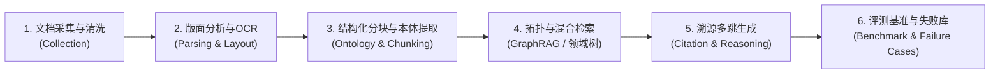

# AI-Lab Line1：文档智能与知识库（Document Intelligence & Knowledge Base）

> **所属组织**：AI-Lab 业务体系  
> **核心使命**：围绕学术文献、课程资料、工程手册与团队数字资产，突破复杂多格式文档的深度解析、结构化提炼与前沿知识检索，为智能体（Agent）打造兼具高精准度、多跳推理与完备可溯源性的下一代领域知识库底座。

---

## 1. 路线简介与定位

在通用大语言模型（LLM）与智能体系统向垂直科研、复杂工程落地的过程中，**原始非结构化文档的解析保真度**与**长链条知识检索的拓扑关联度**是决定系统表现的根本瓶颈。

Line1（文档智能与知识库）作为实验室技术链路的关键数据底座与检索中枢，专注于以下科研与工程目标：

1. **突破极端版面解析难题**：对学术论文、教材、工程图纸等多栏、图表密集、跨页公式混排的复杂 PDF 及异构格式进行高精度版面还原与结构化抽取；
2. **构建严谨领域本体与动态知识网**：引入本体论（Ontology）建模规范，将扁平的文档切片（Chunking）升级为兼具实体、概念、公理与时效标记的领域知识树（Domain Tree）；
3. **深耕前沿检索增强技术（GraphRAG & Multi-Hop RAG）**：结合向量检索、社区摘要（Community Summary）与图拓扑检索，解决多跳跨文档推理、局部/全局信息综合与事实幻觉抑制；
4. **沉淀科研工程基准与资产**：建设端到端解析 Benchmark、高难度问答评测集、真实系统失败案例库（Failure Cases），为后续 Line2（GUI Agent）、Line3（Self-Research 科研探索）以及 Line4（商业化实践）提供标准化接口与数据支撑。

---

## 2. 科研主线与核心技术链路

Line1 拒绝泛泛而谈的“调库问答”，全线工作围绕以下标准数据流水线与科研实验链展开：

### 四大重点攻坚方向

1. **复杂 PDF 解析与版面还原对比（Document Parsing）**
   - 重点对比与攻坚主流及 SOTA 解析引擎（如 MinerU/Magic-PDF、Marker、Nougat、Surya、PaddleOCR、PyMuPDF 等）；
   - 归纳复杂版面识别缺陷（双栏交叉错读、跨页表格断裂、行内与块状公式混淆、脚注图注反插等），建立量化 Benchmark。
2. **领域本体论（Ontology）与动态自更新领域树**
   - 确立核心类（Classes）、属性（Properties）与公理关系（Axiomatic Relations），将传统思维导图升级为形式化知识网络；
   - 引入时效性元数据体系（SOTA、主流状态、发布时间、关联演进），设计前沿学术流监控与增量自动更新管道。
3. **GraphRAG 与高精度检索增强（Advanced Retrieval）**
   - 探索实体抽取、共现图与关系图构建、层次化社区划分（Leiden/Louvain）以及全局/局部混合检索；
   - 针对长程复杂依赖、多篇对比、上下文长度溢出等场景开展对比评测。
4. **智能体记忆机制与评测沙箱（Agent Memory & Harness）**
   - 深入剖析智能体 Working / Episodic / Semantic / Procedural 多级记忆系统设计；
   - 配合任务实例（Task Instance）、评测器（Evaluator）搭建闭环评测工程基准。

---

## 3. 人员梯队与阶梯式成长（L0 ~ L3）

Line1 全面执行 AI-Lab 扁平务实的 **人员分层梯队机制**，不设空头衔，纯粹以“交付成果与实际能力”作为晋升依据：

| 层级              | 定位                 | 准入门槛 / 晋升条件                  | 核心工作内容                                                                    | 代表性交付成果                                  |
| :---------------- | :------------------- | :----------------------------------- | :------------------------------------------------------------------------------ | :---------------------------------------------- |
| **L0 外围关注者** | 探索与实操起步       | 零门槛，不要求代码基础与深厚论文功底 | 经典与前沿论文卡片制作、PDF 转换现象观察、团队资料元数据整理、失败现象收集      | 论文基础卡、Markdown 排版缺陷报告、文档目录清单 |
| **L1 任务参与者** | 工具实验与实操深入   | 按时合格交付至少 4 张 L0 任务卡      | 解析工具小样本对比、最小 RAG Demo 跑通与魔改、论文方法深度拆解、构造问答测试集  | 工具对比评测表、最小 RAG 脚本与日志、QA 验证集  |
| **L2 稳定成员**   | 模块负责人与骨干攻坚 | 连续 2~4 周稳定交付，具独立攻坚能力  | 独立负责解析 Benchmark 建设、知识库核心子模块、本体论领域树构建、失败案例库沉淀 | 可复用数据集、领域树 YAML/JSON-LD、系统阶段报告 |
| **L3 骨干负责人** | 路线统筹与带教把控   | 具备系统级视野与扎实技术储备         | 路线规划、每周任务卡设计与维护、新人指导答疑、组会验收与成果流转                | 任务卡矩阵、周度复盘汇总、对外成果宣发包        |

---

## 4. 成员日常行为与协作守则

为保障全组协同高效运转、杜绝形式主义与低效内耗，全体 Line1 成员必须严格恪守以下五项核心准则：

### 4.1 AI 辅助与独立思考（善用工具，严防幻觉）

- **工具赋能**：鼓励合理使用 Claude、Gemini、DeepSeek、ChatGPT 等 AI 工具辅助编程、查阅资料与排错；
- **强制可运行与溯源核查**：AI 生成的每一行代码必须在本地实际运行并验证通过；AI 提及的论文结论、公式、技术名词必须核对原论文出处；
- **严禁无脑搬运**：禁止直接将未经检验的大模型生成文本大段作为交付物。提交成果时须能清晰阐释其原理与实现逻辑（知其然且知其所以然）。

### 4.2 严格时限（DDL）与请假闭环机制

- **恪守时间底线**：任务卡周期通常为 3~7 天，约定时间即为严格截止节点（DDL）。按时交付是衡量个人工程可靠性的第一标准；
- **事前报备，严禁事后补假**：如遇考试、实验冲突或不可抗力，**必须提前向负责人说明原因并请假**。严禁临近 DDL 或组会当场告知未做，坚决杜绝“失联”；
- **自定新 DDL 形成闭环**：申请延期时，须主动同步已完成的阶段性进展，并**给出明确自定且可行的新交付时间点**，延期只允许发生一次并须彻底闭环。

### 4.3 第一视角实战沉淀（真实有效，拒绝形式主义）

- **拒绝网帖百科拼凑**：严禁无意义抄录网络教程或百科概念，交付重点在于**第一手动手实践记录**；
- **排错笔记必备四要素**：
  1. **环境与可复现步骤**：系统版本、核心依赖、运行命令；
  2. **踩坑与排错（Troubleshooting）**：真实报错堆栈、根因分析定位路径、最终解决方案；
  3. **客观实验对比**：测试输入、真实输出截图/表格、耗时与显存/内存占用等量化数据；
  4. **局限思考与改进计划**：当前做法的瓶颈及下一步优化想法。

### 4.4 组会规范与成果即时流转

- **高效例会**：每周例会聚焦任务卡完成度、核心技术突破与失败用例分析，不回避问题，不做空泛汇报；
- **会后 1 小时内极速上传**：**组会结束后 1 小时内**，参会成员须将最新交付成果、整理后的复盘笔记及修改代码归档上传至本仓库对应目录；
- **缺勤补位机制**：因故请假无法参会者，**必须在组会开始前提前提交阶段性成果与书面说明**，并主动确认补交截止时间。

### 4.5 技术求助与精准提问规范

- **先查后问，杜绝伸手党**：遇阻时优先查阅官方文档、GitHub Issue 并借助 AI 工具探究根因；
- **精准提问三要素**：向组长或组内骨干提问时，严禁发空泛的“报错了怎么办”，必须包含：
  1. **明确目标与运行环境**（正在运行的脚本/任务、操作系统、依赖包版本）；
  2. **已尝试排查步骤与失败现象**（试过哪些方法、在哪个节点异常）；
  3. **完整错误日志与复现代码**（终端完整的 Traceback 报错、关键代码块或截图）；
- **手脑并用，拒绝空谈**：提出技术设想或新方案时，须同步提供最小验证脚本、初探 Demo 或数据支撑，用代码和数据说话。
