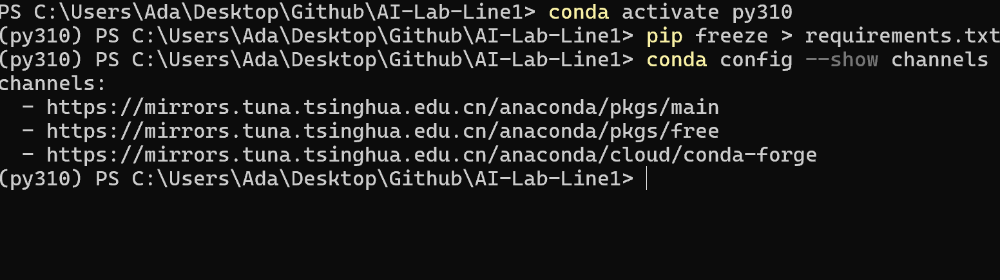

# 通识学习计划和踩坑记录

## 一、通识学习计划

| 时间          | 任务           |
| ------------- | -------------- |
| 10.15-10.17   | Task3 Linux    |
| 10.18-10.21   | Task6 Docker   |
| 10.22-10.28   | Task7 Task8    |
| 10.29-11.4    | Task9          |
| 11.5-11.11    | Task10         |

## 二、踩坑记录

关于Conda:
1.最初安装时，没有把miniconda加入环境变量，最后是手动修改的  

2.忘记配置镜像源，终端反应很慢，后面在.condarc里修改默认channel，在终端也可以改。修改后如图：



3.没有让conda入驻powershell,导致在VS Code里没法稳定链接虚拟环境

```bash
conda init powershell
```  

4.没有关闭自动激活，导致终端运行卡顿

```bash
conda config --set auto-active false
```  

参考链接 [Markdown语法](https://markdown.com.cn/basic-syntax/links.html)