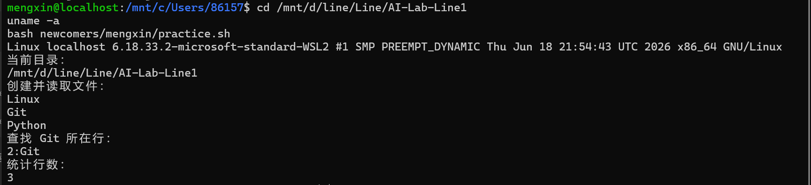

# M1：Bash 命令行练习

## 本次运行环境

Windows + Git Bash。脚本已在 Git Bash 运行成功，已经在wsl Linux 环境验证。

## 我做了什么

在 newcomers/mengxin/practice.sh 中创建脚本，然后执行：

```bash
bash newcomers/mengxin/practice.sh

```


脚本创建临时文件，写入 Linux、Git、Python 三行内容，

读取文件，查找 Git 所在行，并统计行数。

## 实际运行结果

当前目录：/c/Users/86157/AI-Lab-Line1

文件内容：Linux、Git、Python，各占一行。

查找结果：2:Git

行数：3

## 我遇到的问题

粘贴创建脚本的命令时，两次内容连在一起，出现 EOFcat，

导致结束标记没有正确独占一行。

我按 Ctrl+C 取消输入，重新粘贴完整命令，

确保 EOF 单独占一行，然后运行成功。

## 命令理解

\- pwd：显示当前目录。

\- mktemp -d：创建临时目录。

\- printf：把三行内容写入文件。

\- cat：读取文件内容。

\- grep -n：查找匹配内容并显示行号。

\- wc -l：统计行数。

\- trap：脚本退出时执行清理。

## WSL2 Linux 验证

我进入 WSL，在 Linux 环境中执行：

```bash
cd /mnt/d/line/Line/AI-Lab-Line1
uname -a
bash newcomers/mengxin/practice.sh
```

uname 输出包含 microsoft-standard-WSL2 和 GNU/Linux。
脚本成功读取三行内容，查找结果为 2:Git，统计结果为 3，
与之前在 Git Bash 中的结果一致。

Windows 的 D 盘在本次 WSL 环境中通过 /mnt/d 访问。



