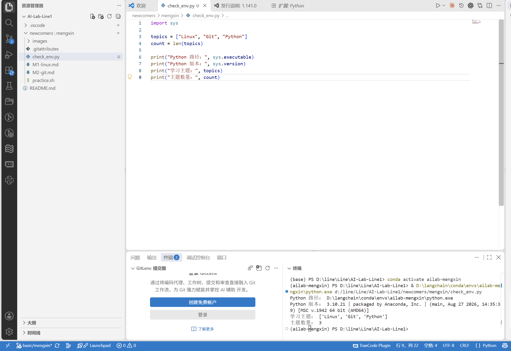
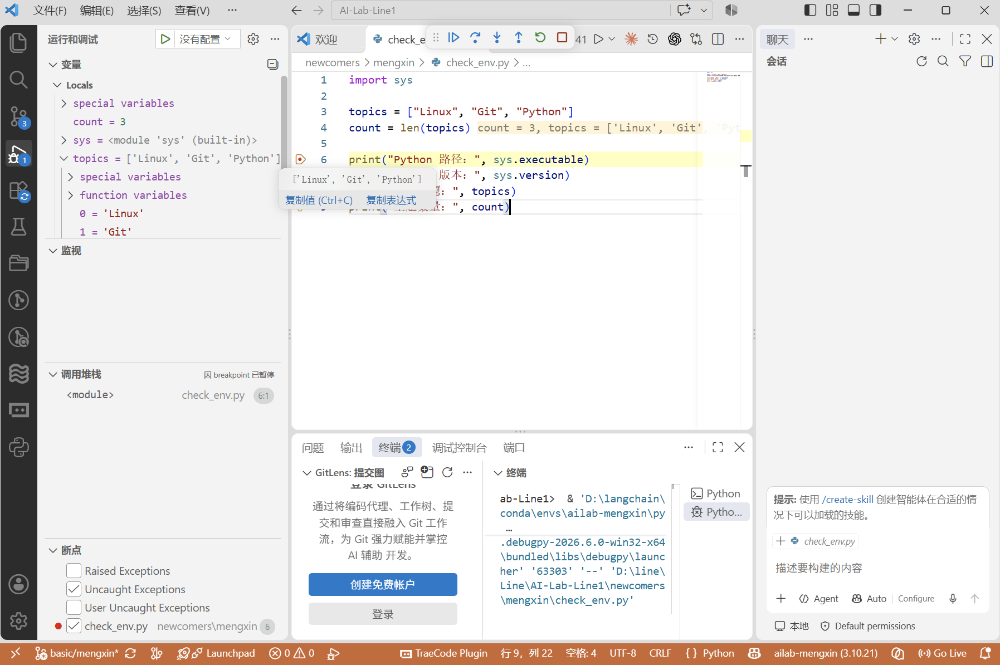
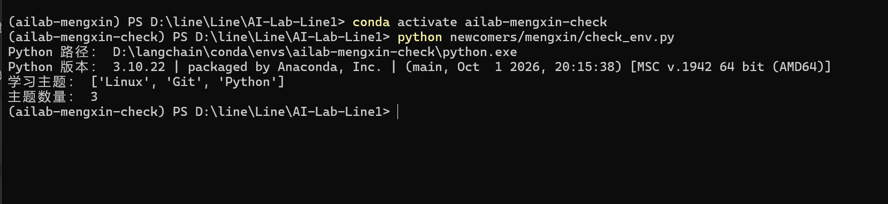

# M3：VSCode 与 Conda 实践

## 环境
- Windows
- VSCode 1.141.0
- Conda 26.7.1
- 原环境：ailab-mengxin，Python 3.10.21
- 重建环境：ailab-mengxin-check，Python 3.10.22

## 实际操作
我创建了独立的 Conda 环境，在 VSCode 中选择该环境的解释器，
运行 check_env.py，确认 Python 路径和主题数量。

随后在第 6 行设置断点，按 F5 启动调试。
程序暂停在打印语句之前，count 已赋值为 3。

## 环境导出与重建
我执行 conda env export --from-history，
将输出保存为 environment.yml，去掉本机专用的 prefix 路径。

然后执行：

```powershell
conda env create -n ailab-mengxin-check -f newcomers/mengxin/environment.yml
conda activate ailab-mengxin-check
python newcomers/mengxin/check_env.py
```

重建环境中的程序运行成功，主题数量为 3。

## 踩坑记录
1. Python 扩展已安装，但工作区未受信任，找不到选择解释器命令。
   信任自己的作业文件夹并启用扩展后，可以选择解释器。
2. 使用 conda run 时中文输出乱码。
   后来激活重建环境，直接使用 python 运行，中文显示正常。
   目前未进一步定位编码问题的具体原因。

## 结果与局限
原环境与重建环境的脚本结果一致。
environment.yml 指定 python=3.10，因此重建时补丁版本可以不同。
本次验证了 Windows 环境重建，尚未验证其他操作系统。

## 运行凭证




