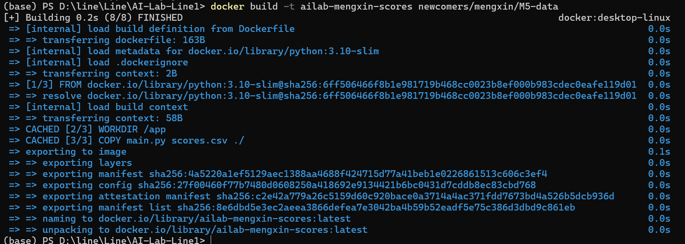
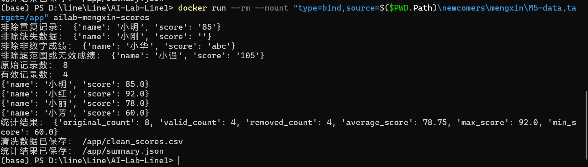

# M6：将成绩清洗程序放进 Docker

## 环境与目标
我在 Windows 上安装 Docker Desktop，使用 WSL2 后端。
docker --version 显示 29.8.2，容器类型为 linux。

目标是把 M5 程序打包，在容器中运行，并比较本地与容器的结果。

## Dockerfile
文件位于 M5-data/Dockerfile：

```dockerfile
FROM python:3.10-slim
WORKDIR /app
ENV PYTHONIOENCODING=utf-8
COPY main.py scores.csv ./
CMD ["python", "main.py"]
```

它使用包含 Python 的基础镜像，
将脚本与输入数据复制到 /app，启动时执行 main.py。
程序仅使用 Python 标准库，因此不需要安装第三方依赖。

## 实际构建与运行
在仓库根目录执行：

```powershell
docker build -t ailab-mengxin-scores newcomers/mengxin/M5-data
docker run --rm ailab-mengxin-scores
```

容器成功运行，结果与本地一致：

| 指标 | 本地 | 容器 |
|---|---:|---:|
| 原始记录 | 8 | 8 |
| 有效记录 | 4 | 4 |
| 平均分 | 78.75 | 78.75 |
| 最高分 | 92 | 92 |
| 最低分 | 60 | 60 |

## 保存输出文件
第一次运行没有挂载目录，结果文件写在容器内部。
使用 --rm 后，容器退出即被删除，内部输出也不保留。

后来我挂载本机目录：

```powershell
docker run --rm --mount "type=bind,source=$($PWD.Path)\newcomers\mengxin\M5-data,target=/app" ailab-mengxin-scores
```

这样输出文件直接写回电脑的 M5-data 文件夹。
运行会覆盖 clean_scores.csv 和 summary.json。

挂载后，容器里的 /app 使用本机文件夹内容；
前面不挂载的运行则验证了镜像中自带的代码和数据。

## 踩坑与排错

### Docker 命令找不到
PowerShell 无法识别 docker。
我检查了常见安装位置、D 盘和安装记录，都没有发现安装，
随后安装 Docker Desktop，新开终端后命令可用。

### Dockerfile 为空
构建提示 the Dockerfile cannot be empty。
我重新保存内容，用 Get-Content 检查磁盘文件后再构建。
此后 Docker 能正确读取文件。

### 下载基础镜像超时
构建时访问 auth.docker.io 超时。
我单独执行 docker pull python:3.10-slim，
这次下载成功，之后构建和运行也成功。
没有进一步确认首次超时的具体原因。

## 我对镜像与容器的理解
镜像是包含程序和运行环境的模板。
容器是根据镜像创建的运行实例。
删除容器不会自动删除镜像。
挂载目录可以让输出文件在容器删除后继续保留。

## 局限
基础镜像未锁定 digest，未来重新构建可能使用更新的版本。
程序仍要求输入包含 name、score 两列。
目录挂载验证仅在 Windows PowerShell 中完成。

## 实际截图


